# ardftsrc Quality Report: Fast (f32)

Version: 0.3.0
Revision: 74b3157

## Preset Configuration

| Field     |        Value |
|-----------|--------------|
| Quality   |          512 |
| Bandwidth |       0.9200 |
| Taper     | Kaiser(30.0) |
| Phase     |            0 |

## HydrogenAudio Test Suite

Local HydrogenAudio Test Suite run, `f32`, no high-precision backend. See <https://src.hydrogenaudio.org/> for the test suite's own scoring methodology.

| Metric               |      Score |
|----------------------|------------|
| Balanced score       |     71.83% |
| Spectrogram          |     51.73% |
| Bandwidth            |     93.95% |
| Impulse frequency    |     50.69% |
| Average impulse freq | -171.35 dB |
| Aliasing             |    100.00% |
| Pre-ringing          |     21.63% |
| Gapless              |    100.00% |
| Intermodulation      |     35.62% |
| Delay                |    100.00% |

### Spectrogram of a sweep 1 to 22 kHz

A sine sweep from 1 to 22 kHz. The ideal plot is a single strong red line. Issues with aliasing effects or filter cutoff would show as extra lines. Noise would appear as dots across the plot (instead of a black background). [96 kHz source resampled to 44 kHz]

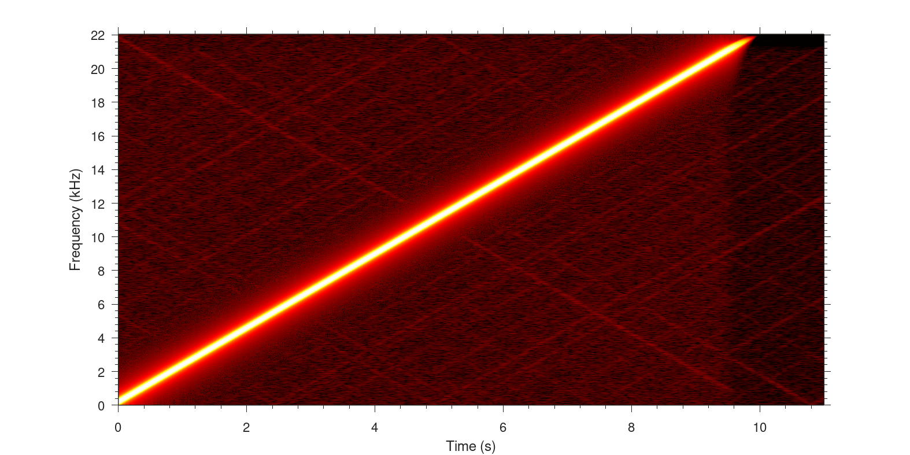

### Spectrogram of a sweep 1 to 22 kHz (extended)

The source signal included a sine sweep all the way up to 44 kHz, however when downsampled to 44 kHz the highest frequency which can be represented is 22 kHz. This plot would show if the sine above 22 kHz is filtering down into the plot, there should be nothing plotted after 10 seconds. [96 kHz source resampled to 44 kHz]

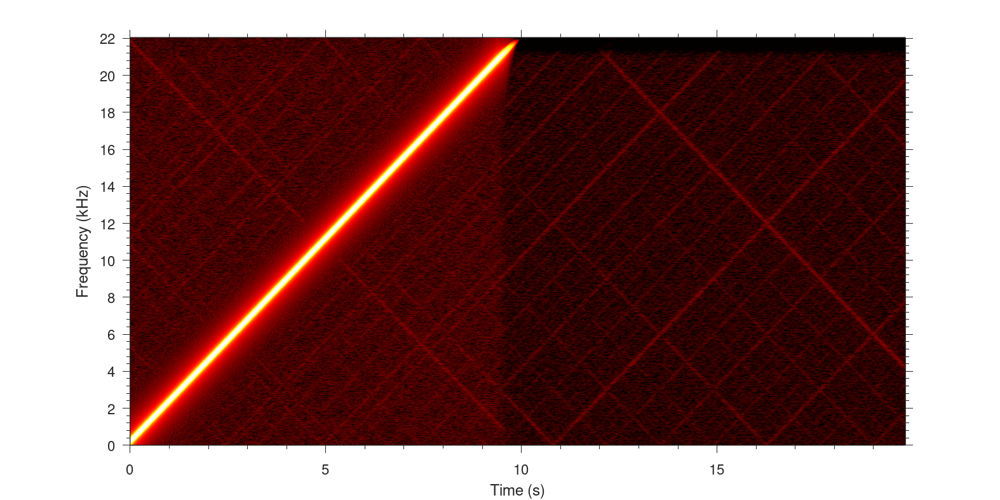

### Aliasing

A 23 kHz sine at -4 dBFS with a white noise floor of -150 dBFS over 30 seconds. The ideal plot is a continuous line touching the -150dB line, many SRC routines engage a gradual filter at 20 kHz which would be visible on this plot. [96 kHz source resampled to 44 kHz]

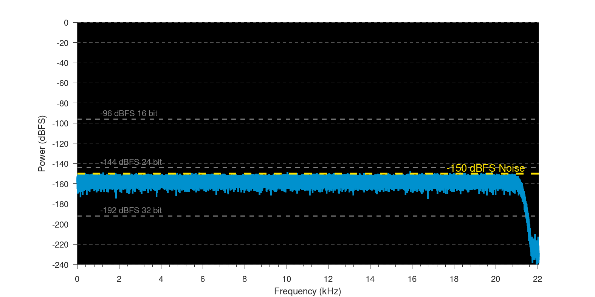

### Nyquist Filter

Zoomed on nyquist frequency (22.050 kHz), the bandwidth of the SRC is displayed. A SRC with 100% bandwidth, that is full frequency preservation would be a straight line of noise. [96 kHz source resampled to 44 kHz]

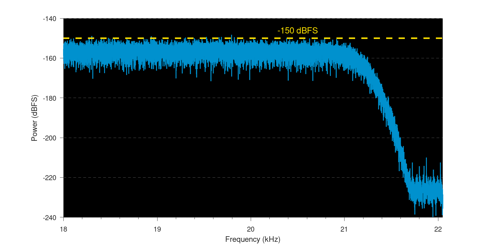

### Intermodulation Harmonic Distortion

Two sine waves one at 64.59 Hz, -6 dBFS and the second at 6998 Hz, -18.0412 dBFS, which equals quarter the amplitude of the first sine. This test will highlight aliasing and dynamic range of processing. It will also show if dither has been applied, look for high frequency signals on the plot. [96 kHz source resampled to 44 kHz]

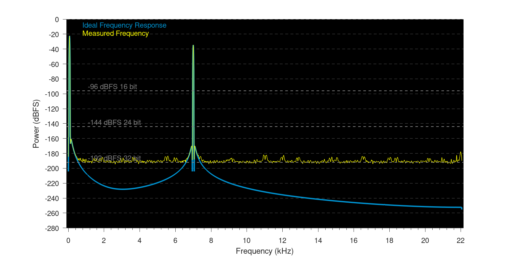

### Intermodulation Harmonic Distortion (difference)

The difference between the ideal and measured signals from the Intermodulation Harmonic Distortion test. [96 kHz source resampled to 44 kHz]

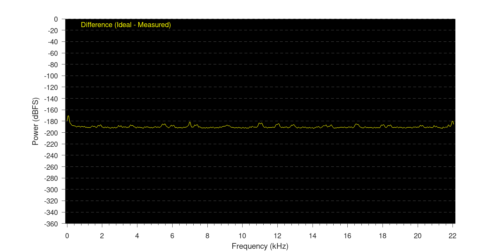

### Impulse Frequency

A frequency response displaying leakage beyond the ideal frequency response. Impulses are at sample positions n so that {n mod 320} is a permutation of {0, 1, 2, . . . , 319}. All fractional differences in sample positions between input and output signal are addressed exactly once. The output signal is upsampled to 14.112 MHz and the impulse responses are added to obtain a high resolution impulse response. [96 kHz source resampled to 44 kHz]

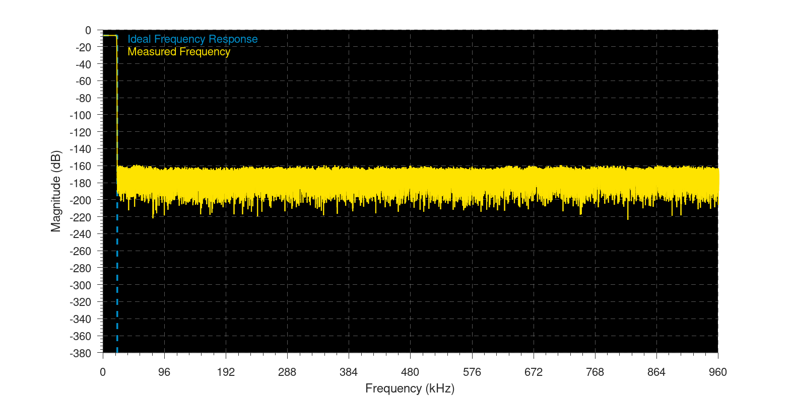

### Impulse Response

Displays the phase response, most SRC balance the response with pre and post ringing, personal preference might prefer a minimum phase response where there is no pre-ringing. The ideal response is not shown because a post-ringing representation, would not tally with the other ideal plots (phase, etc). [96 kHz source resampled to 44 kHz]

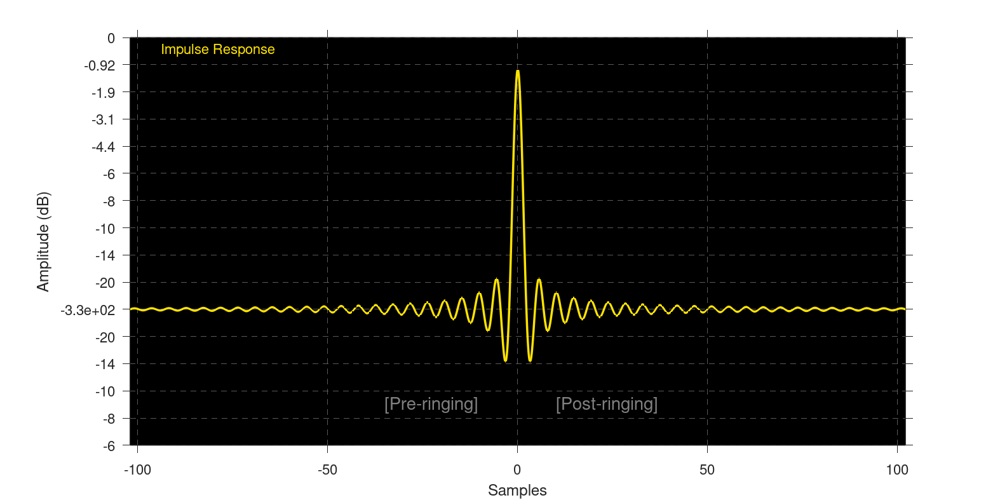

### Impulse Phase

The actual phase across the frequency range. [96 kHz source resampled to 44 kHz]

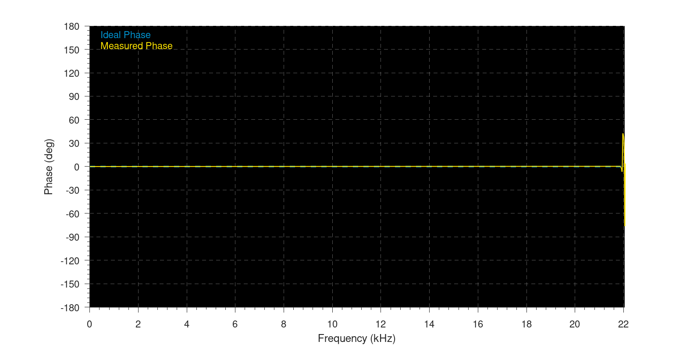

### Impulse Passband

Displays the SRC filter used close to the nyquist frequency. [96 kHz source resampled to 44 kHz]

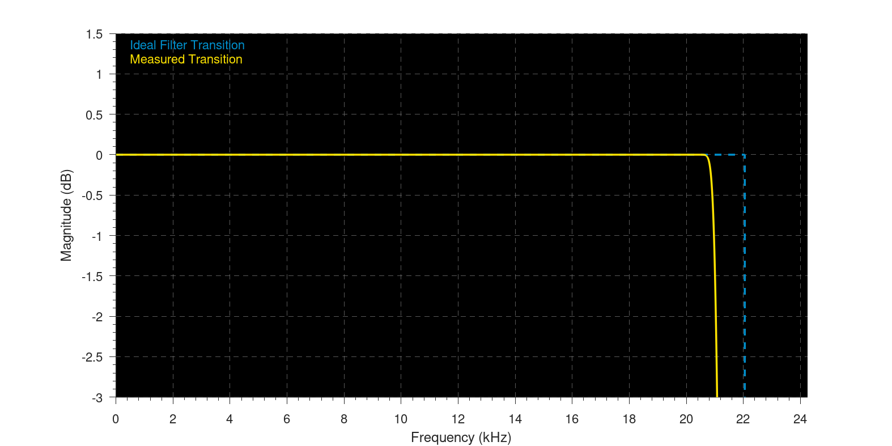

### Impulse Transition

A zoomed plot of the nyquist frequency showing the filter response. [96 kHz source resampled to 44 kHz]

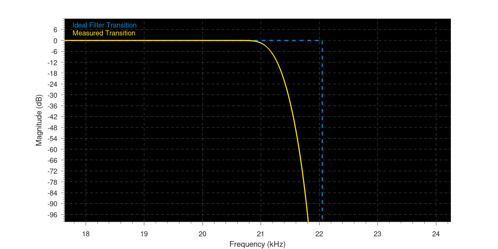

### Gapless Sine

A sine wave is split into two, both are resampled independently. This plot is the two signals joined back together. The blue line shows the transition after resampling. Deviation from sine wave shape likely means an audible glitch. Any value over +1 would clip if later not corrected. [96 kHz source resampled to 44 kHz]

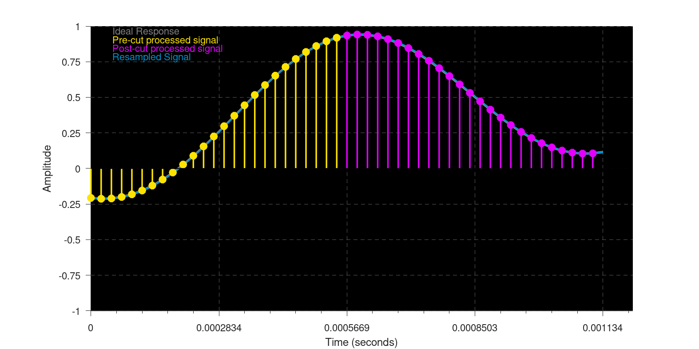

### Gapless Sine (frequency plot)

A frequency plot of the gapless sine test. [96 kHz source resampled to 44 kHz]

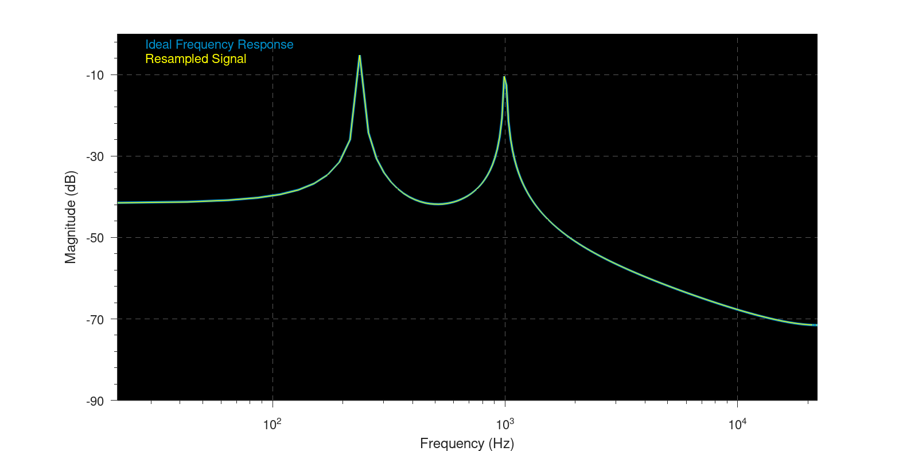

## THD+N and Pre-ringing

THD+N and pre-ringing are measured in `f64` only; see [report_fast.md](report_fast.md).
